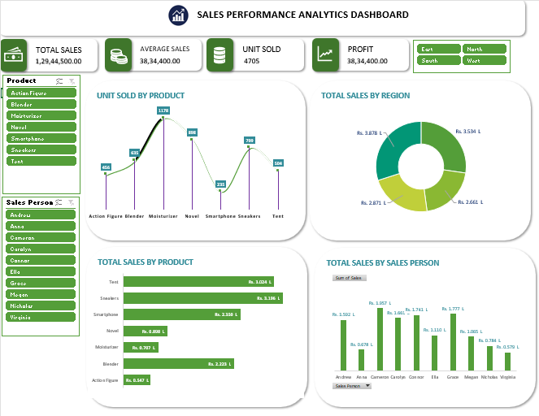

# Excel Sales Performance Analytics Dashboard

## Project Overview

An interactive sales performance analytics dashboard developed using Microsoft Excel to analyze business sales, profitability, product performance, regional sales distribution and salesperson performance.

The project transforms transactional sales data into meaningful business insights through Pivot Tables, charts, KPI cards and interactive slicers.

## Business Objectives

- Monitor overall sales and profitability.
- Identify top-performing products.
- Analyze regional sales performance.
- Evaluate individual salesperson performance.
- Track product demand based on units sold.
- Support data-driven business decision-making.

## Tools and Technologies

- Microsoft Excel
- Pivot Tables
- Pivot Charts
- Interactive Slicers
- Excel Formulas and Functions
- Data Visualization
- Custom Number Formatting

## Dashboard Preview

## Key Performance Indicators

| Metric | Value |
|---|---:|
| Total Sales | ₹1,29,44,500 |
| Total Profit | ₹38,34,400 |
| Average Sales | ₹2,58,890 |
| Total Units Sold | 4,705 |
| Product Categories | 7 |
| Sales Regions | 4 |
| Salespersons | 10 |

## Dashboard Features

- Interactive product, region and salesperson filters.
- Sales and profitability KPI cards.
- Product-wise units sold analysis.
- Regional sales distribution.
- Product-wise revenue analysis.
- Salesperson performance comparison.
- Interactive business performance visualization.

## Key Business Insights

- West emerged as the highest revenue-generating region.
- Sneakers generated the highest product revenue.
- Moisturizer recorded the highest number of units sold.
- Cameron achieved the highest individual sales revenue.
- North recorded the lowest regional sales revenue.
- The overall profit margin was approximately 29.62%.

## Project Workflow

1. Sales data preparation
2. Data formatting and organization
3. Sales and profit calculations
4. Pivot Table creation
5. KPI development
6. Dashboard design
7. Interactive slicer integration
8. Business insights generation

## Repository Structure

- `Sales_Performance_Analytics.xlsx` — Excel workbook containing sales data, Pivot Tables and the interactive dashboard.
- `Sales_Dashboard.png` — Dashboard preview.
- `README.md` — Project documentation.

## How to Use

1. Download the Excel workbook from this repository.
2. Open the workbook in Microsoft Excel.
3. Navigate to the Dashboard worksheet.
4. Use the interactive slicers to explore sales performance.

## Skills Demonstrated

- Data Analysis
- Business Intelligence
- Sales Analytics
- Microsoft Excel
- KPI Reporting
- Dashboard Development
- Data Visualization
- Business Insights Generation

## Conclusion

This project demonstrates how Microsoft Excel can be used to transform transactional sales data into an interactive business intelligence dashboard that supports sales monitoring, performance evaluation and informed decision-making.
